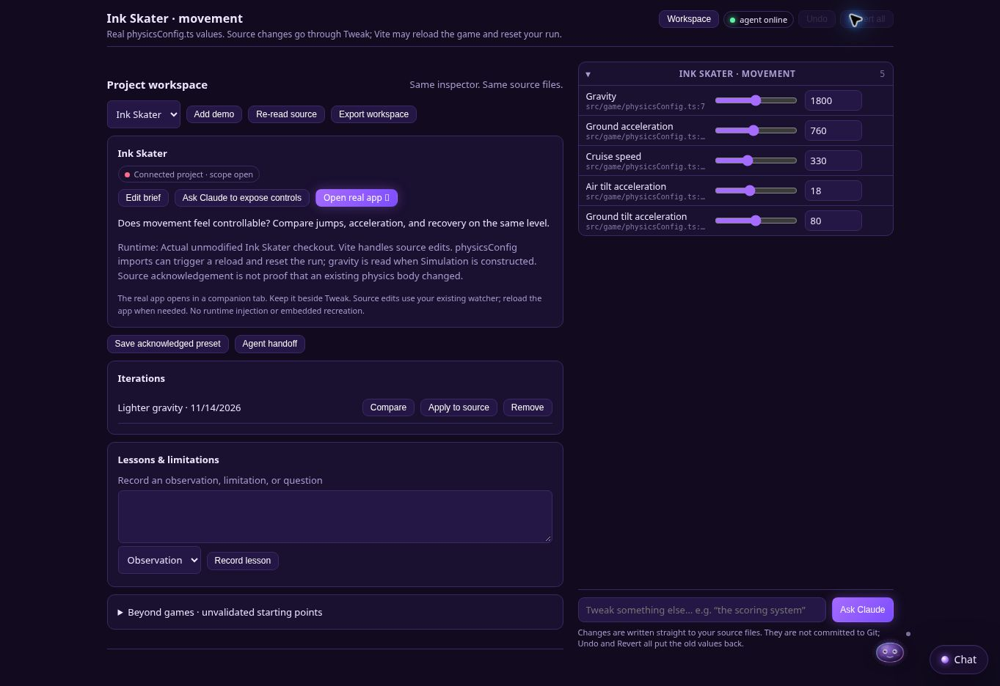

# A workspace inside the real Let’s Tweak

This extends the existing `ui/app.js` inspector. It uses the same Lets SDK shell, model, LIP events, deterministic local agent, source resolver, stale checks, Undo and Revert all. There is no second slider implementation, game copy, runtime injection, or model call for slider changes.



## Start with actual Ink Skater

With these three checkouts side by side (`lets-unique-tweak`, `ink-skater`, `lets`), install the game's dependencies using its existing package manager. From `lets-unique-tweak`:

```sh
node workspace/run.mjs --project ../ink-skater --lets ../lets
```

The launcher runs the **current Ink Skater checkout** with its own Vite dev server and the real Lets engine. Open the two printed local URLs. The workspace automatically connects five parameters from the current `src/game/physicsConfig.ts`; it does not change Ink Skater's code to integrate it. Source mappings resolve again on every launcher start. If the source no longer matches, startup fails and asks for rediscovery.

The real app runs in a companion tab/window. The Lets host deliberately denies framing and cross-origin connections; this extension preserves those protections instead of embedding a replica or weakening the host. Put the game and inspector side by side. Vite watches the current files, including agent edits. A reload may reset the game. Gravity is constructor-bound; it must be tested in a new Simulation. This does not promise live mutation of existing physics objects.

Requires Node 20+, a Lets >=0.7 checkout, and installed Ink Skater dependencies. Optional `--port 4173` and `--app-port 5173` select free loopback ports. No cloud service or deployment is required. The launcher never commits, pushes, installs dependencies, or pulls either repository. Changes persist in the actual working tree after Ctrl+C; use Tweak's Revert all before stopping if you want them undone.

## In an ordinary `/lets tweak` session

Open **Workspace** in the original inspector. Add a demo brief with its real app URL, scope, human evaluation, and known runtime limitations. **Ask Claude to expose controls** uses the existing `tweak.scope` flow; it cannot discover new controls without the coding agent. If Claude is away, the window tells you how to resume.

- Save presets only after every source edit has been acknowledged. Presets are partitioned by project, scope and parameter mapping.
- Compare a saved iteration against current acknowledged values. Apply a preset through the existing source-edit path. Each parameter is independently validated; a preset is not an atomic multi-file transaction. Errors remain visible in the actual inspector.
- Copy a handoff listing changed values and real `file:line` locations, human reasoning, and refresh limitations. It correctly says that edits are already in the working tree.
- Record lessons, limitations, questions and future ideas. Export briefs, snapshots and notes as JSON. Browser storage is local; the export is a portable record, not an import/sync system.
- Use the beyond-game suggestions to create a brief for a real project. They are explicitly unvalidated ideas, not fake running demos.

The catalog is project-local. For a different project, start `/lets tweak` in that project. No remote filesystem access, automatic GitHub updates, shared presets, or background AI discovery is implied.
